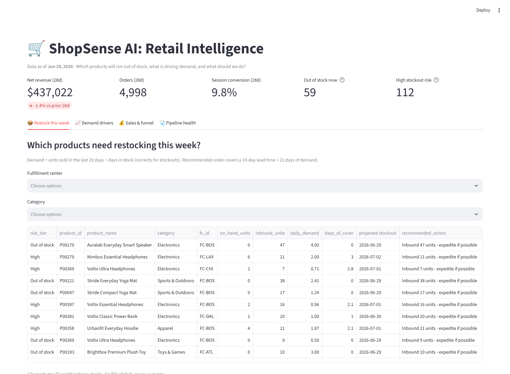
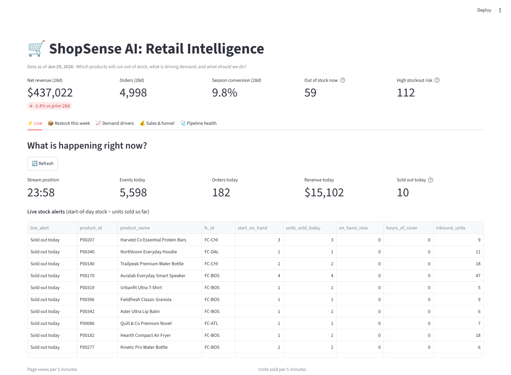
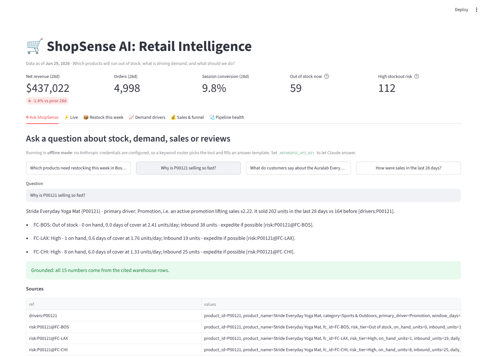
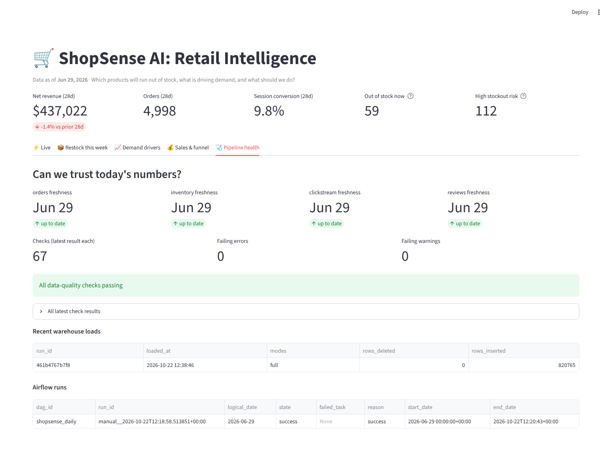

# ShopSense AI | Retail Intelligence and Real-Time Data Platform

[](https://github.com/Inchara-Adigante/Shopsense-AI/actions/workflows/ci.yml)

An end-to-end retail data platform that turns orders, customer activity, inventory and product reviews into reliable business insights.

**Business question:** *Which products are likely to run out of stock, what is driving their demand, and what action should the business take?*



## Roadmap

| Stage | Scope | Status |
|---|---|---|
| **1. Core platform** | Retail data → S3-style lake → PySpark transformations → star-schema warehouse → dashboard | ✅ Done |
| **2. Production reliability** | Incremental loads and backfills, SCD Type 2, data-quality gates, Airflow orchestration, monitoring, runbook, performance evidence | ✅ Done |
| **3. Streaming** | Live orders and clicks with late, too-late and duplicate deliveries; Spark Structured Streaming with watermark, dedup and an exactly-once sink; live stock alerts | ✅ Done |
| **4. AI** | A business assistant that answers from the warehouse through read-only tools, cites the rows behind every number, and has a number-level grounding check; per-product review summaries | ✅ Done |
| **5. AWS deployment** | Lake on S3 through one storage layer, Glue 5.0 jobs, Athena, optional Redshift Serverless, budget alert, all in Terraform; CI | ✅ Infrastructure as code, tested on an AWS emulator. Not yet run on a real AWS account (see [infra/](infra/README.md)). |

## Architecture

```mermaid
flowchart LR
    subgraph SRC["Sources · simulated retailer"]
        direction TB
        STREAM["<b>Live replay</b><br/>orders + clicks<br/>late · too-late · duplicates"]
        BATCH["<b>Daily deliveries</b><br/>orders · items · status<br/>clicks · inventory<br/>catalog · customers<br/>promotions · reviews"]
    end

    subgraph RT["Real time · Spark Structured Streaming"]
        SS["<b>Stream job</b><br/>10-min watermark<br/>dedup within watermark"]
        LIVE[("<b>live tables</b><br/>exactly-once sink")]
    end

    subgraph BP["Batch · daily, orchestrated by Airflow 3 or a Glue workflow"]
        subgraph LAKE["Data lake · local disk or S3"]
            RAW[("<b>raw</b><br/>immutable<br/>SHA-256 manifests")]
            STG[("<b>staging</b>")]
            GATE{{"<b>Quality gate</b><br/>keys · nulls · volume<br/>quarantine rate"}}
            CLEAN[("<b>clean</b><br/>Parquet by<br/>business date")]
            CUR[("<b>curated</b><br/>star schema<br/>SCD Type 2")]
            Q[("<b>quarantine</b><br/>bad rows + reason")]
        end
        subgraph WH["Warehouse · DuckDB or Redshift"]
            DW[("<b>dw</b><br/>5 dims · 5 facts")]
            MART["<b>mart</b><br/>restock · risk · drivers<br/>sales · funnel"]
            OPS[("<b>ops</b><br/>load log · DQ results")]
        end
    end

    subgraph SERVE["Serving"]
        direction TB
        AI["<b>AI assistant</b><br/>read-only SQL tools<br/>citations · grounding check"]
        DASH["<b>Streamlit dashboard</b><br/>Ask · Live · Restock<br/>Drivers · Sales · Health"]
    end

    STREAM --> SS --> LIVE
    BATCH -->|ingest| RAW
    RAW -->|"PySpark clean<br/>new deliveries only"| STG
    RAW -.->|invalid rows| Q
    STG --> GATE -->|publish| CLEAN
    CLEAN -->|PySpark curate| CUR
    CUR -->|"incremental load<br/>one transaction<br/>+ DQ checks"| DW
    DW --> MART
    DW -.-> OPS
    DW -.->|start-of-day stock| LIVE
    MART --> AI --> DASH
    MART --> DASH
    OPS --> DASH
    LIVE --> DASH

    classDef src fill:#eef2ff,stroke:#6366f1,color:#1e1b4b
    classDef store fill:#ecfdf5,stroke:#10b981,color:#064e3b
    classDef bad fill:#fef2f2,stroke:#ef4444,color:#7f1d1d
    classDef proc fill:#fff7ed,stroke:#f97316,color:#7c2d12
    classDef serve fill:#f5f3ff,stroke:#8b5cf6,color:#2e1065
    classDef gate fill:#fefce8,stroke:#ca8a04,color:#422006
    class BATCH,STREAM src
    class RAW,STG,CLEAN,CUR,DW,OPS,LIVE store
    class Q bad
    class MART,SS proc
    class AI,DASH serve
    class GATE gate
    style SRC fill:#fafafa,stroke:#a1a1aa,color:#27272a
    style RT fill:#fafafa,stroke:#a1a1aa,color:#27272a
    style BP fill:#fafafa,stroke:#a1a1aa,color:#27272a
    style LAKE fill:#ffffff,stroke:#d4d4d8,color:#27272a
    style WH fill:#ffffff,stroke:#d4d4d8,color:#27272a
    style SERVE fill:#fafafa,stroke:#a1a1aa,color:#27272a
```



| Layer | What happens | Code |
|---|---|---|
| Generate | Six months of a simulated retailer. Popularity × seasonality × promotions drive demand, and five fulfillment centers with reorder policies produce real stockouts. Products are repriced every Monday, customers move or change membership, and orders are shipped, delivered, cancelled or returned. Dirty data is injected on purpose. | `shopsense/generate/retail_data.py` |
| Ingest | Landing → raw, copied byte-for-byte into `ingest_date=` partitions with SHA-256 manifests. Re-runs are skipped; a changed re-delivery is refused unless `--force`. | `shopsense/ingest/land_raw.py` |
| Clean (PySpark, incremental) | Processes only unseen deliveries (watermark state). Handles typing, two timestamp formats and canonical values; invalid rows go to quarantine with a reason; duplicates are removed on business keys. New rows are **merged into only the business-date partitions they touch** via staging → quality checks → publish. Backfills (`--from/--to`) are idempotent. | `shopsense/transform/clean.py` |
| Curate (PySpark) | Star schema with **SCD Type 2** product and customer dimensions, stable hash surrogate keys, point-in-time lookups, and the latest order status. | `shopsense/transform/curate.py` |
| Warehouse (incremental) | Dimensions are upserted by primary key; facts **replace only the changed date partitions**. One transaction with integrity and quality checks, otherwise it rolls back. Every load is logged to `ops.load_log`. | `shopsense/warehouse/load.py`, `sql/warehouse/` |
| Data quality | Lake checks on staged data: keys, nulls, accepted values, day-over-day volume, quarantine rate. Warehouse checks: freshness, completeness, SCD2 validity, revenue sanity, reconciliation. **Errors block publishing.** | `shopsense/quality/checks.py` |
| Orchestration | Airflow 3 DAG `shopsense_daily` (sensor → ingest → clean → curate → load), with retries and backoff, catch-up backfills, and a `shopsense_reprocess` DAG for corrections | `airflow/` |
| Monitoring | Dashboard tab for freshness, failing checks, quarantine trend, recent loads and Airflow runs, plus an incident runbook | `dashboard/app.py`, `docs/runbook.md` |
| Redshift | Same schema with `DISTSTYLE ALL` dimensions, `DISTKEY(product_key)`, `SORTKEY(date_key)`, S3 `COPY`, and the incremental `DELETE`/`INSERT` pattern (reference, not yet run on AWS) | `sql/redshift/create_tables.sql` |

| AI | Five read-only SQL tools with citation refs. A Claude (`claude-opus-5-5`) tool-use loop with strict schemas, a cached system prompt and refusal fallbacks, or an offline keyword router when no API key is set. A grounding check rejects any number not found in a tool result. Review summaries use SQL numbers, with extractive or Claude Batches text. | `shopsense/ai/` |
| Streaming | A producer replays a day as a messy live stream. Spark Structured Streaming applies a 10-minute watermark and `dropDuplicatesWithinWatermark`, then `foreachBatch` → `INSERT OR IGNORE` (exactly-once with checkpoints). Live views compute 5-minute activity, units sold and stock right now, with alerts. | `shopsense/streaming/`, `sql/live/live.sql` |

| AWS | `SHOPSENSE_LAKE=s3://…` runs the same pipeline on S3 (Spark via S3A, DuckDB via fsspec). Terraform for S3 (versioning, encryption, lifecycle), least-privilege IAM, Glue jobs and workflow, Athena, Redshift Serverless with a usage limit, and a $5 budget alert | `shopsense/storage.py`, `infra/` |

Details: [project report](docs/report.md) · [AWS deployment](infra/README.md) · [data model](docs/data_model.md) · [AI](docs/ai.md) · [streaming](docs/streaming.md) · [performance](docs/performance.md) · [runbook](docs/runbook.md) · [Airflow](airflow/README.md)

## How the stockout answer is built

`mart.restock_this_week` answers the question directly. For each product at each fulfillment center:

1. **Demand estimate:** units sold in the last 28 days ÷ *days the FC actually had stock*. Stockout days would otherwise hide real demand.
2. **Days of cover** = on hand ÷ daily demand, which gives a **projected stockout date**.
3. **Risk tier:** *Out of stock*, *High* (< 7 days of cover), *Medium* (< 14), *Low*.
4. **Action:** reorder enough to cover a 10-day lead time plus 21 days of demand, minus stock on hand and inbound. If stock is already inbound, the action is to expedite it instead.
5. **Why:** `mart.demand_drivers` labels each product as *Promotion*, *Supply constrained*, *Rising / Falling demand* (only with enough volume), or *Stable*.

## Results (seed 42, 180 simulated days)

### Reliability: does incremental processing give the right answer?
- **Incremental = full rebuild.** The lake was built up to day N−4, then 4 more days were processed one at a time. All **10 warehouse tables came out identical** to a full rebuild (row-by-row `EXCEPT ALL` in both directions). The comparison also caught a real bug: a non-deterministic `first()` picked a session's device differently between runs. It's now `min_by(…, event_ts)`.
- **Small loads:** each incremental day replaced 1–3 date partitions for inventory, sessions and activity, and 12–16 for order lines, because status updates reach back to older orders.
- **Backfills are idempotent:** reprocessing three already-loaded days changed **0 rows**.
- **Quality gates work:** a truncated delivery (11 orders against a 186-order median) was **blocked before publishing**. The clean table was unchanged, and the date stayed unprocessed for the retry.
- **Rollbacks work:** an error-level warehouse check rolls back the whole load and keeps the pending changes (tested).

### Data volume and quality

| Table | Raw rows | Clean rows | Quarantined | Duplicates removed |
|---|---:|---:|---:|---:|
| orders | 32,492 | 32,147 | 0 | 345 |
| order_status_updates | 64,551 | 63,893 | 0 | 658 |
| order_items | 55,179 | 54,515 | 122 | 542 |
| clickstream | 1,021,694 | 1,000,738 | 821 | 20,135 |
| inventory_snapshots | 360,000 | 360,000 | 0 | 0 |
| catalog snapshots | 10,800 | 10,800 | 0 | 0 |
| customer CDC | 6,751 | 6,751 | 0 | 0 |
| reviews | 3,490 | 3,477 | 13 | 0 |

- **SCD Type 2:** 400 products became 1,064 versions, with 337 products repriced at least once. 703 customers have more than one version. **100% of order lines match the price of the product version valid on their order date.**
- **11,783 late events** (1–2 days late) were filed under the day they happened.
- **67 data-quality checks**, all passing on the final run.
- Order lifecycle: 29,148 delivered, 1,394 returned, 692 shipped, 648 cancelled (excluded from revenue), 228 still placed. Net revenue is $2.70M, with $123k returned.

### Business output (as of Jun 29, 2026)
- 59 product × FC combinations out of stock and 112 at high risk, putting **$4,755 a day of revenue** at risk.
- Session conversion is 9.8%, and 9.9% of sessions hit an out-of-stock page.

**Backtest of the High flag** (every Monday: did the product × FC actually stock out within 7 days?):

| Demand estimate | Flagged | Caught | Precision | Recall |
|---|---:|---:|---:|---:|
| Stockout-adjusted (used) | 2,163 | 641 | 29.6% | **39.4%** |
| Naive (units ÷ 28 days) | 1,460 | 502 | 34.4% | 30.9% |

The stockout adjustment catches 28% more real stockouts (recall 39.4% vs 30.9%) at lower precision. A days-of-cover rule still misses most stockouts: demand per product and FC is 1–2 units a day, and the feed doesn't say when inbound stock arrives. This is a transparent baseline for later forecasting to beat.

### Streaming ([details](docs/streaming.md))
Replaying Jun 29 (5,626 click events and 289 order lines, sent as 6,080 deliveries with retries and late events):
- **0 on-time or within-watermark events lost and 0 counted twice**, in a single run, across a mid-day restart with re-sent files, and after **killing the live job mid-stream** and resuming from its checkpoint.
- **29 of 29 too-late events dropped** in a single run (28 of 29 after a restart; why that's expected is explained in the doc).
- The job keeps up with a stream at up to 60× real time with the default micro-batch size.

### AWS ([details](infra/README.md))
- **S3 lake = local lake:** the full pipeline with `SHOPSENSE_LAKE=s3://…`, against a local S3-compatible server, gives a warehouse **identical** to the local-disk run (0 differences across 11 tables).
- **Terraform:** `terraform validate` passes in CI, and `terraform apply` against an AWS emulator created 22 of 23 resources (S3, IAM, Glue jobs, workflow and triggers, Athena). The emulator doesn't support the AWS-managed Glue policy, Budgets or Redshift Serverless, so those were left out of that test.
- The clean step is compatible with Glue 5.0 (Spark 3.5).



### AI assistant ([details](docs/ai.md))
- Answers the four core questions (what to restock, why a product is selling, what customers say, recent sales) with **every number traced to a cited warehouse row**. For example, *"Why is P00121 selling so fast?"* → driver *Promotion* (lift ×2.22), 202 vs 164 units, and per-FC stock and actions. Grounding result: 15 of 15 numbers supported.
- The grounding check flags invented figures (tested with a fabricated "$9,876,543 next month").
- Review summaries for the 282 products with at least 3 reviews.
- **Honest status:** the Claude path is tested with a scripted fake client (loop, request shape, errors, refusals, grounding) but **hasn't been run against the live API** here, because no key was available. Without a key, the deterministic offline mode answers instead, and that's what the screenshot shows.



### Performance ([details](docs/performance.md))

| Experiment | Before | After |
|---|---:|---:|
| Raw gzip JSON → Parquet (daily views per product) | 0.488 s | **0.078 s** (6.3×) |
| Partition pruning (one week of sessions) | 181 files / 22 MB | **7 files / 0.8 MB**, 4× faster |
| Small files → one file per day | 0.054 s | **0.022 s** (2.5×) |
| Materialize `mart.product_fc_daily` (21-date backtest) | 0.556 s | **0.342 s** (1.6×) |


*The Airflow row comes from the `airflow dags test` run described in [airflow/README.md](airflow/README.md).*

## Setup

Requirements: **Python 3.12** and **Java 17 or 21** (for Spark).

```bash
git clone https://github.com/Inchara-Adigante/Shopsense-AI.git
cd Shopsense-AI
python3.12 -m venv .venv && source .venv/bin/activate
pip install -r requirements.txt
```

On macOS, install Java with `brew install openjdk@21`. To set up Airflow, see [airflow/README.md](airflow/README.md); it uses its own virtualenv.

## Run

```bash
python -m shopsense.pipeline                 # fresh run: generate → ingest → clean → curate → load → backtest
python -m shopsense.pipeline --skip-generate # incremental: only new deliveries
streamlit run dashboard/app.py               # http://localhost:8501
pytest                                       # 50 tests, about 6.5 minutes (SHOPSENSE_S3_TESTS=1 adds the S3 test)

# the same pipeline with the lake in S3 (any S3-compatible endpoint, or real AWS)
SHOPSENSE_LAKE=s3://my-bucket/lake python -m shopsense.pipeline

# AI (see docs/ai.md) - uses Claude when ANTHROPIC_API_KEY is set, otherwise offline mode
python -m shopsense.ai.assistant "Which products need restocking this week in Boston?"

# streaming (see docs/streaming.md)
python -m shopsense.streaming.producer --day 2026-06-29 --speed 60    # live replay
python -m shopsense.streaming.stream_job --day 2026-06-29 --continuous --reset
```

Individual steps:

```bash
python -m shopsense.ingest.land_raw --date 2026-06-29 [--force]
python -m shopsense.transform.clean                          # new deliveries only
python -m shopsense.transform.clean --from 2026-03-01 --to 2026-03-07   # backfill (idempotent)
python -m shopsense.transform.clean --full                   # rebuild the clean zone
python -m shopsense.transform.curate
python -m shopsense.warehouse.load [--full]                  # incremental by default
python -m shopsense.warehouse.backtest
python -m shopsense.warehouse.benchmark                      # performance experiments
```

## Project structure

```
Shopsense-AI/
├── shopsense/
│   ├── config.py                  # lake / warehouse paths (env-overridable)
│   ├── storage.py                 # local disk or s3:// with one API
│   ├── pipeline.py                # one-command runner with step timings
│   ├── generate/retail_data.py    # simulated retailer + change feeds + dirty data
│   ├── ingest/land_raw.py         # landing → raw, checksums, audit log
│   ├── transform/
│   │   ├── spark.py               # SparkSession (local, S3A, or Glue)
│   │   ├── clean.py               # incremental raw → clean, write-audit-publish
│   │   └── curate.py              # star schema, SCD Type 2
│   ├── quality/checks.py          # lake + warehouse data-quality gates
│   ├── ai/
│   │   ├── tools.py               # read-only SQL tools with citation refs
│   │   ├── assistant.py           # Claude tool-use loop + offline router
│   │   ├── grounding.py           # every number must come from a tool result
│   │   └── reviews.py             # per-product review summaries
│   ├── streaming/
│   │   ├── producer.py            # messy live replay (late, too-late, duplicates)
│   │   └── stream_job.py          # Structured Streaming → exactly-once live tables
│   └── warehouse/
│       ├── load.py                # incremental / full load, integrity, ops log
│       ├── backtest.py            # stockout flag vs what happened
│       └── benchmark.py           # performance experiments
├── sql/
│   ├── warehouse/ddl.sql          # dw, mart and ops schemas
│   ├── warehouse/marts.sql        # sales, funnel, inventory risk, drivers, restock
│   ├── live/live.sql              # live tables + 5-minute / stock views
│   └── redshift/create_tables.sql
├── airflow/dags/shopsense_daily.py
├── dashboard/app.py               # Streamlit: ask, live, restock, drivers, sales, pipeline health
├── infra/
│   ├── glue/shopsense_job.py      # Glue job entry point (clean / curate)
│   └── terraform/                 # S3, IAM, Glue, Athena, Redshift Serverless, budget
├── .github/workflows/ci.yml       # tests, terraform validate, wheel build
├── docs/                          # report, data model, runbook, performance, screenshots
└── tests/                         # unit, end-to-end, incremental-vs-full
```

## Notes and limitations
- **Synthetic data:** the retailer is simulated, so the right answer is known. That makes the backtest and the SCD2 price check possible.
- **AWS is tested on emulators, not a real account:** the S3 code path and the Terraform are verified against local AWS emulators, and CI validates the Terraform. Nothing has been deployed to a real AWS account, the Glue jobs haven't run on Glue, and the Redshift DDL hasn't run on Redshift. By default everything runs locally: DuckDB stands in for Redshift and file-based topics for Kinesis or Kafka (mapping in docs/streaming.md).
- **Curated is rebuilt each run** (about 20 s here), while clean and the warehouse are incremental. At larger scale, curate would also process only the changed partitions.
- **AI:** without an API key the assistant uses deterministic templates, so its language is plain; the Claude path is written and tested against a fake client but not yet run against the live API.
- **Lead time** is fixed at 10 days for the reorder recommendation, because the inventory feed doesn't carry supplier lead times.
