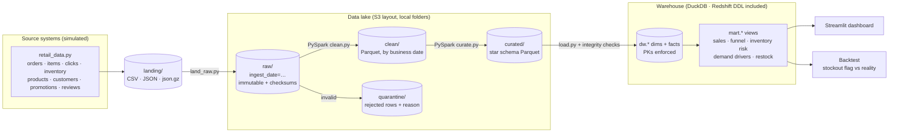
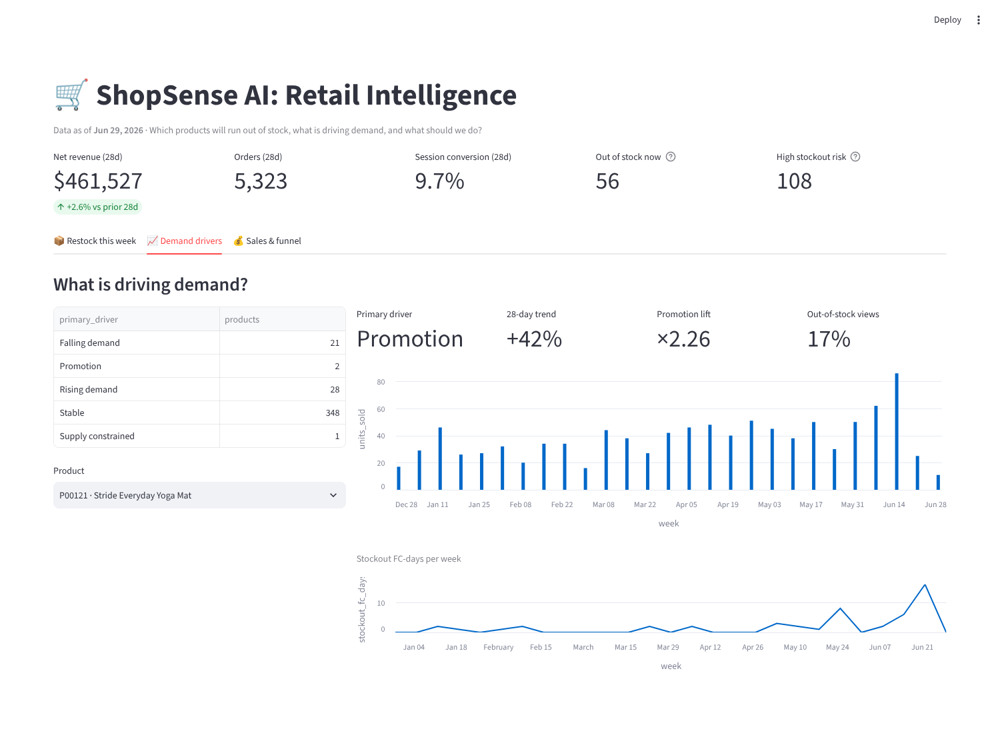

# ShopSense AI | Retail Intelligence and Real-Time Data Platform

An end-to-end retail data platform that turns orders, customer activity, inventory and product reviews into reliable business insights.

**Business question:** *Which products are likely to run out of stock, what is driving their demand, and what action should the business take?*


## Roadmap

| Stage | Scope | Status |
|---|---|---|
| **1. Core platform** | Retail data → S3-style lake → PySpark transformations → star-schema warehouse → dashboard | ✅ Done |
| 2. Production reliability | Airflow orchestration, incremental loads, data-quality checks, monitoring, backfills, SCD Type 2, real S3 (MinIO/AWS) | Planned |
| 3. Streaming | Simulated live orders and clicks, deduplication, late-event handling with watermarks | Planned |
| 4. AI | Review summaries and a business assistant that cites the metrics behind its answers | Planned |

## Architecture (stage 1)



| Layer | What happens | Code |
|---|---|---|
| Generate | Six months of a simulated retailer: popularity × seasonality × promotions drive demand; five fulfillment centers with reorder-point policies produce real stockouts; dirty data is injected on purpose | `shopsense/generate/retail_data.py` |
| Ingest | Landing → raw, copied byte-for-byte into `ingest_date=` partitions with SHA-256 manifests. Re-runs are skipped; a changed re-delivery is refused unless `--force` | `shopsense/ingest/land_raw.py` |
| Clean (PySpark) | Typing, two timestamp formats, canonical categories and statuses, validation rules → quarantine with reasons, dedup on business keys, Parquet partitioned by business date (late events land in the right day) | `shopsense/transform/clean.py` |
| Curate (PySpark) | Star schema: 5 dimensions with surrogate keys and unknown members, 5 facts at explicit grains | `shopsense/transform/curate.py` |
| Warehouse | Full refresh in one transaction, enforced primary keys, orphan-key and row-count checks, business marts | `shopsense/warehouse/load.py`, `sql/warehouse/` |
| Redshift | Same schema with `DISTSTYLE ALL` dimensions, `DISTKEY(product_key)`, `SORTKEY(date_key)` and S3 `COPY` (reference, not yet run on AWS) | `sql/redshift/create_tables.sql` |
| Dashboard | Restock list with actions, demand drivers per product, sales and funnel | `dashboard/app.py` |

The data model, lake zones and design decisions are in [`docs/data_model.md`](docs/data_model.md).

## How the stockout answer is built

`mart.restock_this_week` answers the question directly. For each product at each fulfillment center:

1. **Demand estimate:** units sold in the last 28 days ÷ *days the FC actually had stock*. A product that was out of stock for half the window really sells twice as fast as its raw average suggests.
2. **Days of cover** = on hand ÷ daily demand, which gives a **projected stockout date**.
3. **Risk tier:** *Out of stock* (0 on hand), *High* (< 7 days of cover), *Medium* (< 14), *Low*.
4. **Action:** reorder enough to cover a 10-day lead time plus 21 days of demand, minus stock on hand and inbound. If stock is already inbound, the action is to expedite it instead.
5. **Why:** `mart.demand_drivers` labels each product as *Promotion* (lift ≥ 1.3× while on promo), *Supply constrained* (≥ 20% of page views saw "out of stock"), *Rising / Falling demand* (±25% vs the prior 28 days, only with enough volume), or *Stable*.

## Results (seed 42, 180 days, 2,000 product × FC combinations)

**Data volume and quality**

| Table | Raw rows | Clean rows | Quarantined | Duplicates removed |
|---|---:|---:|---:|---:|
| orders | 32,441 | 32,105 | 0 | 336 |
| order_items | 55,197 | 54,550 | 104 | 543 |
| clickstream | 1,023,234 | 1,002,452 | 875 | 19,907 |
| inventory_snapshots | 360,000 | 360,000 | 0 | 0 |
| reviews | 3,480 | 3,468 | 12 | 0 |

- Every legacy-format timestamp (2% of orders) parsed, and every messy status and category was mapped to its canonical value.
- **11,876 events arrived 1–2 days late**, and all of them were filed under the day they happened.
- Reconciliation checks: warehouse net revenue matches the clean lake to the cent ($2,754,403.27), converted sessions equal clean orders, and there are 0 orphan keys.

**Business output (as of Jun 29, 2026)**
- 56 product × FC combinations out of stock and 108 at high risk, putting **$4,182 a day of revenue** at risk.
- Session conversion is 9.8%, and **10.5% of sessions hit an out-of-stock page**.

**Backtest: is the High flag right?** On every Monday in the history I checked whether each product × FC flagged High actually stocked out within 7 days (21 weeks, 33,070 observations, 1,735 real stockouts).

| Demand estimate | Flagged | Caught | Precision | Recall |
|---|---:|---:|---:|---:|
| Stockout-adjusted (used) | 2,069 | 661 | 31.9% | **38.1%** |
| Naive (units ÷ 28 days) | 1,814 | 615 | 33.9% | 35.4% |

The stockout adjustment catches more real stockouts (recall +2.7 points) at slightly lower precision. A rule this simple still misses most stockouts: demand per product and FC is only 1–2 units a day, so random variation is large, and the inventory feed doesn't say *when* inbound stock will arrive. This is a transparent baseline that the forecasting work in later stages has to beat.

**Runtime and storage:** the full pipeline runs in about 2.5 minutes on a laptop (generate 58 s, clean 66 s, curate 17 s, warehouse load 1.5 s). The lake is 38 MB raw → 33 MB clean → 8.3 MB curated. Writing one file per date partition instead of Spark's default cut the clean zone from 51 MB to 33 MB and avoided hundreds of tiny files.



## Setup

Requirements: **Python 3.12** and **Java 17 or 21** (for Spark).

```bash
git clone https://github.com/Inchara-Adigante/Shopsense-AI.git
cd Shopsense-AI
python3.12 -m venv .venv && source .venv/bin/activate
pip install -r requirements.txt
```

On macOS, install Java with `brew install openjdk@21`.

## Run

```bash
python -m shopsense.pipeline                 # generate → ingest → clean → curate → load → backtest
streamlit run dashboard/app.py               # open http://localhost:8501
pytest                                       # 21 tests, about 80 s
```

Or one stage at a time:

```bash
python -m shopsense.generate.retail_data     # landing files (--days, --seed)
python -m shopsense.ingest.land_raw          # landing → raw (--date, --force)
python -m shopsense.transform.clean          # raw → clean + quarantine
python -m shopsense.transform.curate         # clean → star schema
python -m shopsense.warehouse.load           # curated → warehouse + marts
python -m shopsense.warehouse.backtest       # evaluate the stockout flag
```

Query the warehouse directly:

```bash
duckdb warehouse/shopsense.duckdb "SELECT * FROM mart.restock_this_week LIMIT 10"
```

## Project structure

```
Shopsense-AI/
├── shopsense/
│   ├── config.py                 # lake / warehouse paths (env-overridable)
│   ├── pipeline.py               # end-to-end runner with step timings
│   ├── generate/retail_data.py   # simulated retailer + dirty data
│   ├── ingest/land_raw.py        # landing → raw, checksums, audit log
│   ├── transform/
│   │   ├── spark.py              # SparkSession (local now, Glue later)
│   │   ├── clean.py              # raw → clean + quarantine
│   │   └── curate.py             # clean → star schema
│   └── warehouse/
│       ├── load.py               # DuckDB load + integrity checks
│       └── backtest.py           # stockout flag vs what happened
├── sql/
│   ├── warehouse/ddl.sql         # warehouse tables (PKs enforced)
│   ├── warehouse/marts.sql       # sales, funnel, inventory risk, drivers, restock
│   └── redshift/create_tables.sql
├── dashboard/app.py              # Streamlit
├── docs/                         # data model, screenshots
└── tests/                        # unit + end-to-end tests
```

## Notes and limitations
- **Synthetic data:** the retailer is simulated, so the "right answer" is known. That's what makes the backtest possible.
- **Local stand-ins for AWS:** the lake uses the S3 folder layout on local disk, Spark runs locally instead of on AWS Glue, and DuckDB plays the role of Redshift. Stage 2 adds real S3 (MinIO locally, AWS optionally) and runs the Redshift DDL.
- **Lead time:** fixed at 10 days for the reorder recommendation, because the inventory feed doesn't carry supplier lead times.
