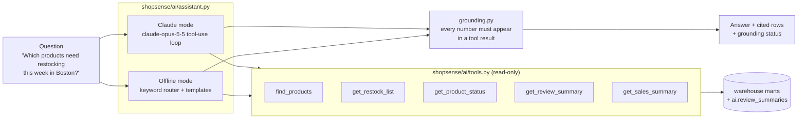

# AI Layer (Stage 4)

The AI sits on top of the data platform, not instead of it. Every number it states comes from the warehouse marts built in stages 1–3, through read-only tools. A grounding check rejects any number that doesn't.



## Tools
Each tool runs one SQL query against the marts and returns rows. Each row carries a **ref**, for example `restock:P00170@FC-BOS` or `drivers:P00121`. Answers cite refs in square brackets, and the dashboard shows the cited rows under **Sources**.

| Tool | Reads | Use |
|---|---|---|
| `find_products(query)` | `dw.dim_product` (current versions) | turn "the Voltix power bank" into product ids |
| `get_restock_list(fc_id, category, limit)` | `mart.restock_this_week` | what to reorder or expedite this week, most revenue at risk first |
| `get_product_status(product_id)` | `mart.inventory_risk`, `mart.demand_drivers` | stock risk per FC, and *why* it's selling (promotion, trend, stockouts) |
| `get_review_summary(product_id)` | `ai.review_summaries` | what customers say |
| `get_sales_summary(days, category)` | `mart.daily_sales`, `dw.fact_order_item` | revenue, orders, units and returns vs the previous period |

All five tool schemas use `strict: true` (every property required, `additionalProperties: false`, optional filters as nullable), so Claude's tool arguments always validate.

## Claude mode
`ClaudeBackend` runs a manual tool-use loop on **`claude-opus-5-5`**:
- **System prompt:** answer only from tool results, cite refs, don't estimate or extrapolate, lead with the action. It's sent as a cached block (`cache_control: ephemeral`), so repeated questions reuse the prefix.
- **Effort** is `medium`, which suits short analytical Q&A. Thinking is adaptive (always on for this model).
- **Refusal fallbacks are on:** `fallbacks: "default"` with the `server-side-fallback-2026-07-01` beta. If a safety classifier declines, the API re-runs the request on Anthropic's recommended fallback model. A final `stop_reason: "refusal"` is still handled.
- **Tool calls:** every tool result from a turn goes back in one user message. A failing tool returns `is_error: true` to Claude instead of crashing the loop. The loop stops after 8 rounds.

**Status:** this path is unit-tested with a scripted fake client. The tests check the loop, the request shape (model, strict tools, cached system prompt, fallbacks), error handling, refusals and grounding. **It hasn't been run against the live API in this repo**, because no API key was available while building it. Set `ANTHROPIC_API_KEY` (or log in with `ant auth login`) and the assistant and review summaries switch to Claude automatically.

## Offline mode
With no credentials, `OfflineBackend` routes the question with keywords:
- product id or name → `get_product_status`, or `get_review_summary` for review questions
- "restock / run out / reorder" with a city, FC or category → `get_restock_list`
- "revenue / sales / orders" with "last N days" → `get_sales_summary`

It then fills a template from the returned rows. It's deterministic and free, so the dashboard and tests work without a key. It handles ambiguity explicitly. Category words such as "Sports & Outdoors" aren't treated as product names. When several products match a name equally well (five "Voltix … Power Bank"s), it answers for the one with the least stock cover and lists the others.

## Grounding check
`grounding.check(answer, tool_results, question)` extracts every number from the answer. It ignores numbers inside refs, product and FC ids, calendar dates, and numbers the user wrote. It then requires each one to match a value from that turn's tool results, allowing for formatting (`1,234`, `$1,234.50`, `15.2%` for 0.152) and rounding.

The check caught a real issue during development: the offline template said "in the last 28 days", where 28 was a constant in code, not a tool value. The fix was to have the tool return `window_days`. The tests also confirm that a Claude-style answer with an invented forecast ("$9,876,543 next month") is flagged.

## Review summaries (`shopsense/ai/reviews.py` → `ai.review_summaries`)
- **Numbers are always SQL:** review count, average rating, % positive (4–5★), % negative (1–2★), and the last-28-day average vs before.
- **Words:**
  - *Extractive* (default without credentials): the phrases that follow "the" in review text (for example "battery life" or "build quality"), ranked by how much more often they appear in positive than in negative reviews.
  - *Claude* (when credentials exist): one **Message Batches** request per product (50% cheaper, asynchronous), with a JSON-schema structured output (`summary`, `praise`, `complaints`, `overall_sentiment`) at `effort: low`. Claude is told not to write numbers; its prose is appended to the SQL-numbers sentence. Batches don't accept `fallbacks`, so a refused or failed product keeps its extractive summary.
- Rebuilt by the pipeline after each warehouse load. 282 products have at least 3 reviews and get a summary.

## Try it

```bash
python -m shopsense.ai.reviews                          # build summaries (claude if credentials, else extractive)
python -m shopsense.ai.assistant "Which products need restocking this week in Boston?"
python -m shopsense.ai.assistant "Why is P00121 selling so fast?" --json
streamlit run dashboard/app.py                          # 🤖 Ask ShopSense tab
```

Example (offline mode, data as of 2026-06-29):

> Stride Everyday Yoga Mat (P00121), primary driver: Promotion, i.e. an active promotion lifting sales ×2.22. It sold 202 units in the last 28 days vs 164 before [drivers:P00121].
> - FC-BOS: Out of stock. 0 on hand, 0.0 days of cover at 2.41 units/day; inbound 38 units, expedite if possible [risk:P00121@FC-BOS].
> - FC-LAX: High. 1 on hand, 0.6 days of cover at 1.76 units/day; inbound 19 units, expedite if possible [risk:P00121@FC-LAX].
>
> grounding: OK (15 numbers checked, 4 rows cited)
