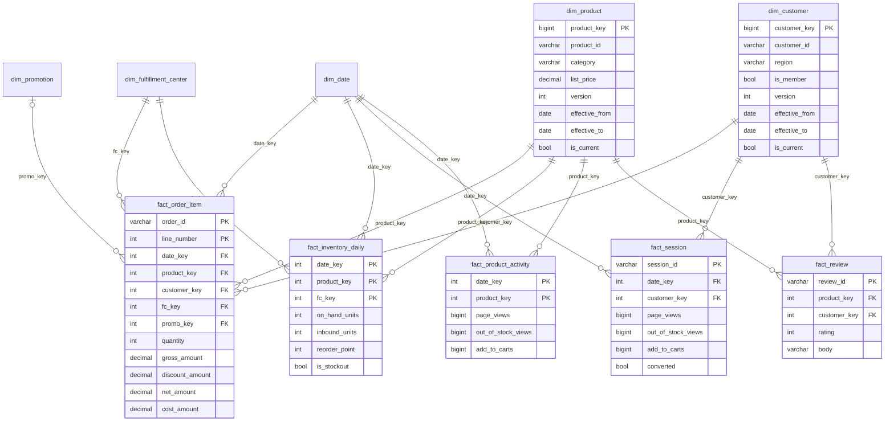

# Data Model

## Lake zones

| Zone | Path | Format | Partitioned by | Written by |
|---|---|---|---|---|
| Landing | `data/landing/<source>/<date>/` | CSV, JSON lines, gzip JSON | delivery date | source systems (simulated) |
| Raw | `lake/raw/<source>/ingest_date=<date>/` | unchanged copy + `_manifest.json` | `ingest_date` | `shopsense/ingest/land_raw.py` |
| Clean | `lake/clean/<table>/` | Parquet (snappy) | business date (`order_date`, `event_date`, `snapshot_date`) | `shopsense/transform/clean.py` |
| Quarantine | `lake/quarantine/<table>/` | Parquet: reason + original record as JSON | none | `shopsense/transform/clean.py` |
| Curated | `lake/curated/<table>/` | Parquet star schema | none (small) | `shopsense/transform/curate.py` |
| Staging | `lake/_staging/<table>/` | Parquet, transient | as clean | `clean.publish()`: write → audit → publish |
| State | `lake/_state/` | JSON | none | processed ingest dates, pending warehouse changes |
| Audit | `lake/_audit/` | JSON lines | none | every stage: ingest log, clean runs, DQ results, pipeline runs |

Raw is partitioned by when data *arrived*, and clean by when it *happened*. A click from Monday that arrives on Tuesday sits in raw under `ingest_date=Tuesday` and in clean under `event_date=Monday`. The `arrival_lag_days` column records the difference.

## Star schema

## Fact grains

| Fact | Grain | Rows (180 days) | Main questions |
|---|---|---:|---|
| `fact_order_item` | one order line | 54,550 | revenue, units, margin, promotion effect |
| `fact_inventory_daily` | FC × product × day | 360,000 | stock position, stockout days |
| `fact_session` | one web/app session | 328,000+ | conversion, out-of-stock experience |
| `fact_product_activity` | product × day | 66,760 | views, add-to-carts, lost-demand signals |
| `fact_review` | one review | 3,468 | ratings; review text for the AI assistant (stage 4) |

## Design decisions

- **Stable surrogate keys:** each key is a 64-bit hash of (natural key, `effective_from`). Adding a new SCD2 version adds a key without renumbering existing ones, so the warehouse can load incrementally without rewriting old facts. Natural keys such as `product_id` stay on the dimension.
- **SCD Type 2:** `dim_product` is built from weekly catalog snapshots. Repeated identical snapshots are collapsed, and a new version starts only when the name, category, brand, price or cost changes. `dim_customer` is built from a daily CDC feed (new signups, region moves, membership changes). Version 1 is valid from 1900-01-01, so activity before the first extract still resolves.
- **Point-in-time lookups:** every fact picks the version valid on its own date, so a January order keeps January's price. A test checks that 100% of order lines match the list price of the version they point to.
- **Unknown members (`key = -1`):** a fact row whose lookup fails is still counted, and it's easy to find, instead of an inner join dropping it silently. The current data has none, and the tests check that.
- **Order status is mutable:** orders move through placed → shipped → delivered, or get cancelled or returned. The latest status comes from the status-update feed, so an incremental load refreshes old order dates when their status changes.
- **Primary keys enforced in the warehouse:** loading a duplicate grain fails the load instead of double-counting revenue.
- **Marts:** most are views. `mart.product_fc_daily` is materialized because the backtest reads it 21 times, which made it 1.6× faster (see `docs/performance.md`). The stockout logic is a table macro, `mart.inventory_risk_as_of(date)`, so the same SQL can be backtested on any past date.
- **`ops` schema:** `ops.load_log` records every warehouse load (mode, partitions, rows deleted and inserted), and `ops.dq_results` mirrors every data-quality check result.
