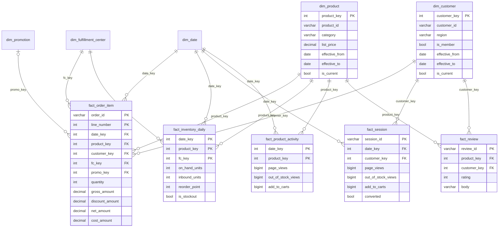

# Data Model

## Lake zones

| Zone | Path | Format | Partitioned by | Written by |
|---|---|---|---|---|
| Landing | `data/landing/<source>/<date>/` | CSV, JSON lines, gzip JSON | delivery date | source systems (simulated) |
| Raw | `lake/raw/<source>/ingest_date=<date>/` | unchanged copy + `_manifest.json` | `ingest_date` | `shopsense/ingest/land_raw.py` |
| Clean | `lake/clean/<table>/` | Parquet (snappy) | business date (`order_date`, `event_date`, `snapshot_date`) | `shopsense/transform/clean.py` |
| Quarantine | `lake/quarantine/<table>/` | Parquet: reason + original record as JSON | none | `shopsense/transform/clean.py` |
| Curated | `lake/curated/<table>/` | Parquet star schema | none (small) | `shopsense/transform/curate.py` |
| Audit | `lake/_audit/` | JSON / JSON lines | none | every stage |

Raw is partitioned by when data *arrived*, and clean by when it *happened*. A click from Monday that arrives on Tuesday sits in raw under `ingest_date=Tuesday` and in clean under `event_date=Monday`. The `arrival_lag_days` column records the difference.

## Star schema

## Fact grains

| Fact | Grain | Rows (180 days) | Main questions |
|---|---|---:|---|
| `fact_order_item` | one order line | 54,550 | revenue, units, margin, promotion effect |
| `fact_inventory_daily` | FC × product × day | 360,000 | stock position, stockout days |
| `fact_session` | one web/app session | 328,000+ | conversion, out-of-stock experience |
| `fact_product_activity` | product × day | 66,760 | views, add-to-carts, lost-demand signals |
| `fact_review` | one review | 3,468 | ratings; review text for the AI assistant (stage 4) |

## Design decisions

- **Surrogate keys:** dimensions use integer keys, so facts stay narrow and joins are fast. Natural keys such as `product_id` stay on the dimension.
- **Unknown members (`key = -1`):** a fact row whose lookup fails is still counted, and it's easy to find, instead of an inner join dropping it silently. The current data has none, and the tests check that.
- **SCD Type 2 columns:** `effective_from`, `effective_to` and `is_current` are already on `dim_product` and `dim_customer`. Stage 2 fills them when product prices or customer attributes change.
- **Primary keys enforced in the warehouse:** loading a duplicate grain fails the load instead of double-counting revenue.
- **Marts are views over the facts:** the stockout logic is a table macro, `mart.inventory_risk_as_of(date)`, so the same SQL can be backtested on any past date.
