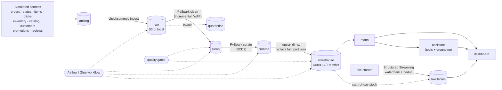

# ShopSense AI: Project Report

**Business question:** which products will run out of stock, what is driving their demand, and what should the business do?

**Answer delivered:** a ranked restock list with a projected stockout date, a recommended order quantity, and the demand driver behind each product and fulfillment center. It's updated daily by a batch pipeline and intraday by a streaming pipeline, and you can ask about it in plain English through an assistant that cites the warehouse rows behind every number.

## 1. Scope

| Stage | What was built | Evidence |
|---|---|---|
| 1. Core platform | Simulated retailer (6 months, 400 products, 6,000 customers, 5 FCs) → checksummed raw zone → PySpark cleaning with quarantine → star schema (5 dims, 5 facts) → DuckDB warehouse with enforced keys → marts → Streamlit dashboard | Revenue reconciles lake ↔ warehouse to the cent; 0 orphan keys |
| 2. Production reliability | Incremental processing with watermarks, write-audit-publish, idempotent backfills, SCD Type 2 with stable hash keys, incremental warehouse load, 67 data-quality checks, Airflow 3 DAGs, pipeline-health page, runbook, performance benchmark | Incremental build is row-for-row identical to a full rebuild across all 10 tables |
| 3. Streaming | Messy live replay (late, too-late and duplicate deliveries) → Spark Structured Streaming (watermark + `dropDuplicatesWithinWatermark`) → idempotent `INSERT OR IGNORE` sink → live stock alerts | 0 lost and 0 double-counted events, including after a hard kill mid-stream |
| 4. AI | Read-only SQL tools with citation refs, a Claude tool-use loop and an offline router, a number-level grounding check, review summaries | 15 of 15 numbers grounded in the example answer; an invented figure is flagged |
| AWS | Storage layer (local or `s3://`), S3A for Spark, Glue 5.0 job script and wheel, Terraform (S3, IAM, Glue, Athena, Redshift Serverless, budget), CI | S3 lake = local lake (0 differences across 11 tables); 22/23 resources applied on an AWS emulator |

## 2. Architecture



## 3. Key design decisions

| Decision | Why | Trade-off |
|---|---|---|
| Raw partitioned by **arrival** date, clean by **business** date | Raw is an exact, replayable record of deliveries. Clean puts each late event under the day it happened. | Two partition schemes to explain |
| **Write-audit-publish** for every clean table | Quality checks run on staged data; bad data never reaches published partitions | One extra write per table |
| Merge + dedupe on business keys everywhere | Re-running or backfilling any date is safe (idempotent) | Reads the affected partitions on each run |
| **Hash surrogate keys** (natural key + `effective_from`) | Adding an SCD2 version never renumbers old keys, so facts load incrementally | 64-bit keys instead of compact integers |
| Point-in-time dimension lookups | A January order keeps January's price (verified for 100% of order lines) | Range join instead of an equi-join |
| Fact **partition replace** in the warehouse | Simple, idempotent, and handles order-status changes that reach back to old dates | Rewrites whole days, not single rows |
| Streaming sink = **idempotent insert on event_id** | Exactly-once results with at-least-once delivery and replays | Needs a primary-key store (DuckDB here; DynamoDB or Redshift on AWS) |
| AI only sees data through **read-only tools**, plus a **grounding check** | The model can't invent numbers without being flagged | Answers limited to what the tools expose |
| Local stand-ins (folders, local Spark, DuckDB, files as topics) behind a **storage layer** | Free to develop and test; the same code runs on S3 and Glue | Cloud execution verified on emulators, not on a real account |

## 4. Results (seed 42, 180 simulated days)

### Data quality and correctness
- **Cleaning:** 32,492 raw order rows → 32,147 clean (345 resent duplicates removed). 55,179 order lines → 54,515 (122 quarantined, 542 duplicates removed). 1.02M click events → 1.00M (821 quarantined, 20,135 retries removed). **11,783 late events** filed under the correct day.
- **Reconciliation:** warehouse net revenue equals the clean lake to the cent; converted sessions equal clean orders; 0 orphan foreign keys.
- **SCD Type 2:** 400 products → 1,064 versions (337 repriced), and 703 customers with history. **100%** of order lines carry the price of the version valid on their order date.
- **Incremental = full rebuild:** 4 incremental days produced warehouse tables **identical** to a full rebuild (`EXCEPT ALL` in both directions, all 10 tables).
- **Quality gates:** 67 checks. A truncated delivery (11 orders vs a 186 median) was **blocked before publishing**, and a warehouse check failure rolls back the whole load.
- **S3:** the full pipeline with the lake in S3, on a local S3-compatible server, gives a warehouse **identical** to the local-disk run.

### Business output (as of 2026-06-29)
- 59 product × FC combinations out of stock and 112 at high risk, putting **$4,755 of revenue per day** at risk. Session conversion is 9.8%, and 9.9% of sessions hit an out-of-stock page.
- **Backtest of the 7-day High flag:** recall **39.4%** with the stockout-adjusted demand estimate, vs 30.9% for the naive estimate, at 29.6% vs 34.4% precision. That's an honest baseline: demand per product × FC is only 1–2 units a day, and inbound arrival dates aren't in the feed.

### Streaming (Jun 29 replay: 6,080 deliveries for 5,626 click events and 289 order lines)
| Run | Too-late dropped | On-time events lost | Double-counted |
|---|---:|---:|---:|
| Uninterrupted | 29 / 29 | 0 | 0 |
| Restart mid-day + re-sent files | 28 / 29 | 0 | 0 |
| Killed mid-stream, resumed from checkpoint | 28 / 29 | 0 | 0 |

### Performance
| Change | Before | After |
|---|---:|---:|
| Raw gzip JSON → Parquet | 0.488 s | 0.078 s (6.3×) |
| Partition pruning (1 week) | 181 files / 22 MB | 7 files / 0.8 MB (4×) |
| One file per day instead of many small files | 0.054 s | 0.022 s (2.5×) |
| Materialized base mart (backtest) | 0.556 s | 0.342 s (1.6×) |
| Full local pipeline (generate → load → reviews → backtest) | n/a | ≈ 4.5 min |

## 5. Problems the tests caught (and how they were fixed)
1. **Non-deterministic aggregation.** `first(device)` picked a session's device differently between runs, so incremental ≠ full rebuild for 6,782 sessions. Fixed with `min_by(device, event_ts)`.
2. **Out-of-order stream files.** Spark's file source orders new files by modification time (ms precision). Files copied in a burst were read out of order, which pushed the watermark ahead and dropped 23 on-time orders. Fixed by stamping each file with its arrival time, the ordering Kafka and Kinesis give through offsets.
3. **Watermark semantics.** One too-late event slipped through after a restart. That's Spark's documented one-sided guarantee: data later than the watermark *may* be dropped. The tests now assert exactly that contract.
4. **Events before the first catalog snapshot.** Sessions that started just before midnight on day 1 found no product version, and the primary-key constraint caught the resulting collision. Fixed by making version 1 valid from the beginning of time and aggregating after the lookup.
5. **Simulation realism.** Logged-in browsing before signup produced 22k unknown-customer sessions, and the final day's late events were never delivered. Both fixed in the generator.
6. **Dashboard KPI.** Summing per-category order counts double-counted multi-category orders (8,376 vs 5,323 orders). Fixed by counting distinct orders from the fact table.
7. **Terraform drift.** Applying to an AWS emulator showed a perpetual `execution_class` diff on the Glue jobs. Fixed by setting it explicitly.
8. **Hard-coded numbers in AI answers.** The grounding check flagged "28 days" in a template as unsupported. The tool now returns `window_days`.

## 6. Limitations and next steps
- **Real AWS run:** the Terraform has been applied to an emulator, and the S3 code path is tested, but nothing has been deployed to a real account or run on Glue yet. Next step: `terraform apply` on a personal account behind the $5 budget alert.
- **Claude in production:** the Claude tool-use loop is tested with a scripted fake client only, because no API key was available. Next step: run it live and build a small evaluation set of questions with expected tool calls and grounded answers.
- **Forecasting:** the stockout flag is a transparent days-of-cover rule (39% recall a week ahead). A demand model using seasonality, promotions and lead-time estimates is the natural next improvement, and the backtest harness is ready to score it.
- **Scale:** curated is rebuilt each run (about 20 s here); at larger volumes it would also process only changed partitions.

## 7. How to reproduce
```bash
python3.12 -m venv .venv && source .venv/bin/activate && pip install -r requirements.txt
python -m shopsense.pipeline          # about 4.5 minutes
streamlit run dashboard/app.py
pytest                                # 50 tests (+ SHOPSENSE_S3_TESTS=1 for the S3 test)
```
