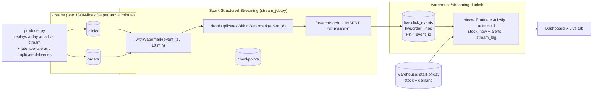

# Streaming (Stage 3)

The batch pipeline answers questions about *yesterday*. The streaming path answers *right now*: what's selling today, and which products have already sold out at which fulfillment center.



## How each streaming problem is handled

| Problem | What the producer does | How the job handles it |
|---|---|---|
| **Out-of-order events** | 2% of events arrive 2–8 minutes late | The 10-minute watermark keeps them. Each is stored under its event time, so it lands in the right 5-minute window. |
| **Very late events** | 0.5% arrive 20–60 minutes late | Older than the watermark, so they're dropped. Spark reports them as `numRowsDroppedByWatermark`, shown in Stream health. |
| **Duplicate deliveries** | 3% are delivered twice (retries 5–60 s later) | `dropDuplicatesWithinWatermark(event_id)` removes them. Anything that still gets through, such as a re-sent file, is ignored by `INSERT OR IGNORE` on the `event_id` primary key. |
| **Crash or restart** | n/a | The checkpoint records the files read by each micro-batch, so the job resumes exactly where it stopped. A replayed batch is a no-op, again thanks to the primary key. |
| **Half-written files** | Writes `.tmp` files, then renames them | Spark ignores dot-files and only sees complete files. |
| **File ordering** | Sets each file's mtime to its arrival minute | Spark's file source reads new files in modification-time order. Kafka and Kinesis give this guarantee through offsets; a file-based source has to provide it. A test caught this: copied files had near-identical mtimes, so Spark read later minutes first and pushed the watermark ahead. |
| **Reader and writer at the same time** | n/a | DuckDB allows one writer process or many readers. The job opens a connection per batch, the dashboard uses short-lived read-only connections, and both retry briefly on a lock. |

## Measured results (Jun 29 replay: 5,626 click events, 289 order lines)

| Run | Deliveries read | Duplicates removed | Too-late dropped | Within-watermark events missing |
|---|---:|---:|---:|---:|
| One uninterrupted run | 6,080 | 165 | **29 of 29** | **0** |
| Stop halfway, deliver the rest, resume, then re-send files | n/a | n/a | 28 of 29 | **0** |
| Live at 600× speed, **killed mid-stream**, then resumed from the checkpoint | n/a | n/a | 28 of 29 | **0** |

In every run, the stored events equal the truth: no duplicates, no event that was never sent, and nothing inside the watermark lost.

**Why "28 of 29" isn't a bug:** Spark guarantees it *never drops* data that's less late than the watermark delay. Data later than that is dropped *in almost all cases*. An event can slip through if it lands in the same micro-batch as the events that will advance the watermark, because the watermark only moves between batches. Where the batch boundaries fall changes with restarts, so one borderline event (40 minutes late, in the last minutes of the day) got in after a restart. The tests check exactly this contract: nothing on time is ever lost, nothing is ever counted twice, and too-late events are dropped apart from rare borderline cases.

**Throughput:** with the defaults (5 files, or about 5 simulated minutes, per 5-second micro-batch), the job keeps up with a stream at up to about 60× real time. At 600× it falls behind. The Stream health metrics show the growing lag, and the backlog drains once input slows. Raising `SHOPSENSE_STREAM_MAX_FILES` increases throughput. On-time data is still never dropped, but more borderline too-late events can slip in.

## Live views
- `live.product_activity_5m`: page views, out-of-stock views and add-to-carts per product, in 5-minute windows.
- `live.units_5m`: units and revenue per product × FC, in 5-minute windows.
- `live.stock_now`: start-of-day stock from the warehouse minus units sold so far, plus hours of cover at normal demand and an alert. Alert states, in priority order: *Sold out today*, *Under 12h of cover*, *Out of stock since open*, *Restock arrived* (sold more than it opened with, so a supplier delivery came in).
- `live.stream_lag`: arrival delay per 5-minute window.

## Run it

```bash
# terminal 1: a live replay of Jun 29, one simulated hour every 60 s
python -m shopsense.streaming.producer --day 2026-06-29 --speed 60
# terminal 2: the streaming job (5-second micro-batches)
python -m shopsense.streaming.stream_job --day 2026-06-29 --continuous --reset
# terminal 3
streamlit run dashboard/app.py               # ⚡ Live tab, press Refresh
```

Or write the whole day at once and process it in one go: `producer` without `--speed`, then `stream_job` without `--continuous`.

## On AWS
The local pieces map directly to managed services:

| Local | AWS |
|---|---|
| `stream/clicks`, `stream/orders` | **Kinesis Data Streams** or **Amazon MSK** (Kafka) topics; Firehose → S3 for the file-based variant |
| `stream_job.py` | **Spark Structured Streaming on EMR / EMR Serverless** or a **Glue streaming job**, reading Kinesis/Kafka instead of files (offsets replace the mtime ordering) |
| Checkpoints | S3 |
| `live.*` tables | DynamoDB, or **Redshift streaming ingestion** from Kinesis |
